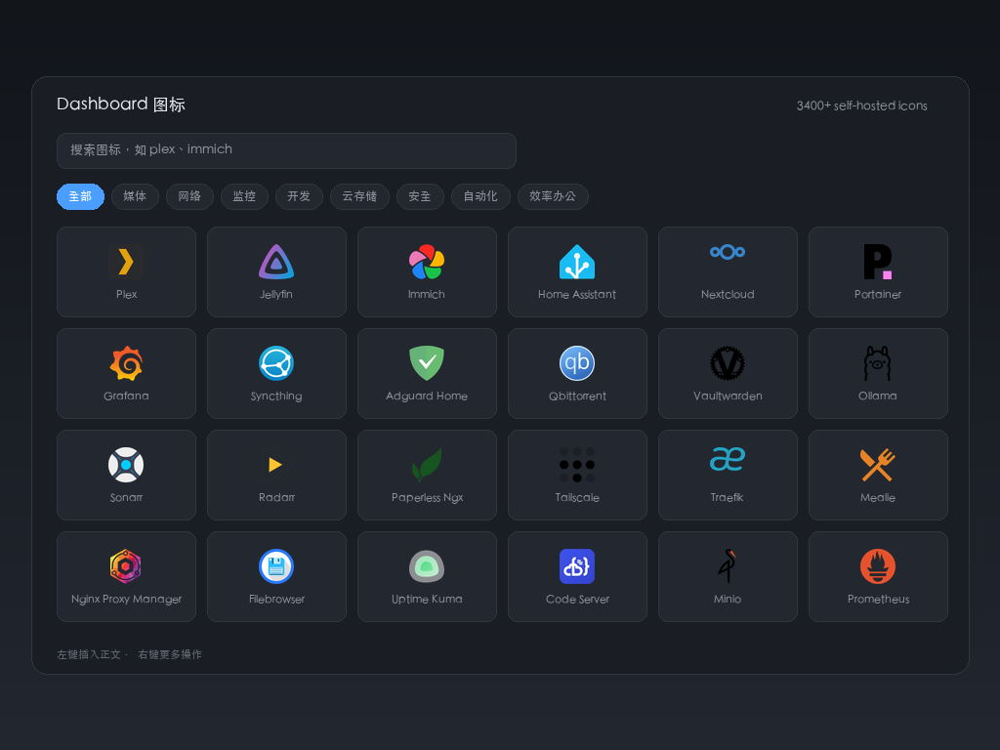

# Dashboard Icons

Self-hosted service icons for SiYuan, powered by [homarr-labs/dashboard-icons](https://github.com/homarr-labs/dashboard-icons).

3400+ icons covering NAS, Docker, *arr stacks, monitoring, home automation and self-hosted apps. Search, click, done — straight into your document or as the document icon.



## Features

- Four entry points: top bar, toolbar, breadcrumb button and `⌥⇧D`
- Local index search, ~2 ms, no network round-trip
- 12 categories: Media, Network, Monitoring, Developer, Cloud, Security, Automation, Productivity, AI, Database, Social, Other
- **Left click** inserts into the document, **right click** offers set-as-document-icon, copy link, download only, refresh preview
- Picks the right icon variant for your light/dark theme automatically (`-light` is for dark backgrounds, `-dark` is for light ones)
- Recently used icons float to the top

## Where files land

| Action | Location | Reference |
| --- | --- | --- |
| Set as document icon | `data/emojis/dashboard-icons/` | `/emojis/dashboard-icons/xxx.png` |
| Insert into document | `assets/dashboard-icons/` | `/assets/dashboard-icons/xxx.png` |

Only the icons you actually use get downloaded. Delete those two folders to clean up.

Set insert mode to "Reference remote URL" if you prefer not to store files in your workspace.

## Settings

- **Icon source**: jsDelivr (default) / GitHub raw / custom mirror
- **Insert mode**: download to assets (recommended) / reference remote URL
- **Match names only**: search only icon names and slugs, ignoring aliases and categories
- **Recent icons**: 0 disables
- **Breadcrumb button / status bar button**: toggles

## Refreshing the index

```bash
python3 scripts/sync-icons.py
```

Fetches upstream `metadata.json`, normalizes categories, infers the missing ones and writes `icons.json` (~343 KB, 59 KB gzipped). Repackage afterwards.

`scripts/make-assets.py` regenerates `icon.png` and `preview.png` (needs Pillow).

## License and trademarks

Plugin code is MIT. Icon assets come from homarr-labs/dashboard-icons under **Apache-2.0**; the full text is in [`licenses/dashboard-icons-LICENSE.txt`](licenses/dashboard-icons-LICENSE.txt).

Icons are fetched from the official CDN on demand — no icon files are bundled with this plugin.

Upstream trademark notice, quoted verbatim:

> All product names, trademarks, and registered trademarks are the property of their respective owners. Icons are used for identification purposes only and do not imply endorsement.

This is an unofficial third-party plugin. It is not affiliated with or endorsed by Homarr Labs.

## Known limitations

- Works on mobile, but the grid collapses to two or three columns on narrow screens
- Document icons rely on SiYuan's emoji mechanism, so they also show up under the `dashboard-icons` group in the emoji picker
- Roughly half of the upstream records carry no category, so the sync script guesses from the slug; long-tail services land in "Other"
