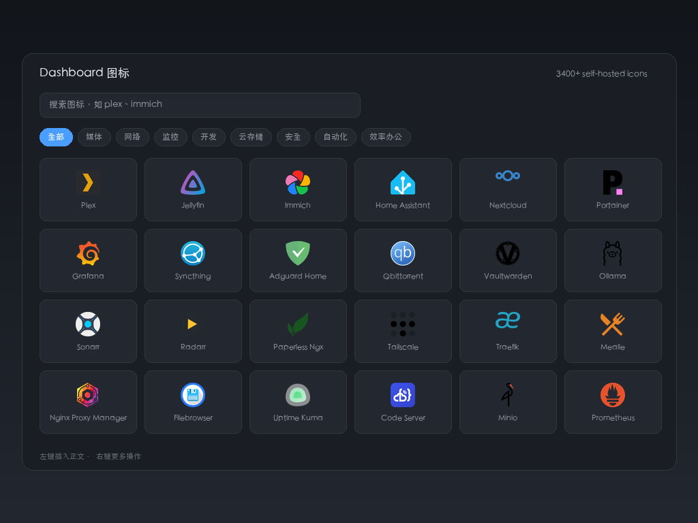

# Dashboard 图标

给思源笔记用的自托管服务图标库，数据来自 [homarr-labs/dashboard-icons](https://github.com/homarr-labs/dashboard-icons)。

3400+ 个图标，覆盖 NAS、Docker、*arr、监控、智能家居、自建服务。搜索、点一下，插进正文或者直接变成文档图标。



## 功能

- 顶栏按钮 / 工具栏按钮 / 面包屑按钮 / 快捷键 `⌥⇧D`，四个入口都能打开
- 本地索引搜索，2 ms 出结果，不联网
- 12 个大类筛选：媒体、网络、监控、开发、云存储、安全、自动化、效率办公、AI、数据库、社交娱乐、其他
- **左键**插入正文，**右键**菜单可设为文档图标、复制链接、仅下载、刷新预览
- 自动跟随思源明暗主题选择图标变体（`-light` 给深色背景用，`-dark` 给浅色背景用）
- 最近使用过的图标自动置顶

## 两种落盘方式

| 动作 | 落盘位置 | 引用路径 |
| --- | --- | --- |
| 设为文档图标 | `data/emojis/dashboard-icons/` | `/emojis/dashboard-icons/xxx.png` |
| 插入正文 | `assets/dashboard-icons/` | `/assets/dashboard-icons/xxx.png` |

都只下载你实际点过的那几个，不会把 3400 个图标灌进工作空间。想清空直接删这两个目录。

如果不想占笔记仓库空间，在设置里把「正文插图方式」改成「直接引用外链」，图片就只存 CDN 地址。

## 设置

- **图标源**：jsDelivr（默认）/ GitHub raw / 自定义镜像
- **正文插图方式**：下载到 assets（推荐）/ 引用外链
- **最近使用数量**：0 关闭
- **面包屑按钮 / 状态栏按钮**：开关

## 更新图标数据

上游每天有新图标进来。拉一次元数据重新生成索引：

```bash
python3 scripts/sync-icons.py
```

脚本会抓 `metadata.json`，归一化分类、推断缺失分类、生成 `icons.json`（约 343 KB，gzip 后 59 KB）。重新打包即可。

集市图标和预览图由 `scripts/make-assets.py` 生成（需要 Pillow）。

## 授权与商标

本插件代码 MIT。图标资源来自 homarr-labs/dashboard-icons，**Apache-2.0**，许可证全文见 [`licenses/dashboard-icons-LICENSE.txt`](licenses/dashboard-icons-LICENSE.txt)。

图标文件通过官方 CDN 按需拉取，插件本身不打包任何图标资源。

上游的商标声明，原样转述：

> All product names, trademarks, and registered trademarks are the property of their respective owners. Icons are used for identification purposes only and do not imply endorsement.

本插件是第三方作品，与 Homarr Labs 无隶属关系，未获其背书。

## 已知限制

- 移动端能用，但面板较窄时网格会退化成两三列
- 设置文档图标依赖思源的表情目录机制，图标会出现在表情面板的 `dashboard-icons` 分组里
- 上游约一半图标的分类字段为空，脚本用 slug 关键词推断，长尾服务会落到「其他」
